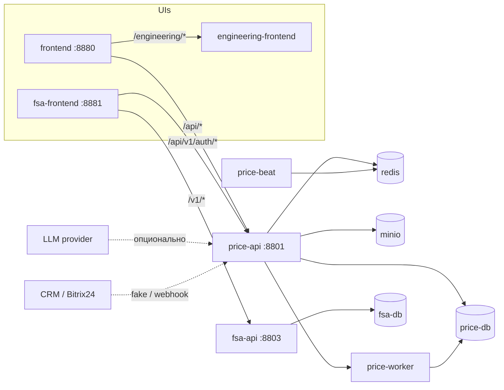

# Supplier Document Automation


> **EN TL;DR** — A self-hosted pipeline that turns supplier price lists and technical
> documents (XLSX exports, PDF scans, passports, certificates) into normalized, versioned
> price data and finished commercial quotes. Known workbook layouts are parsed by
> deterministic rules; an optional OpenAI-compatible LLM path proposes new rules and the
> system degrades to a manual review queue when no key is configured. Ships as a single
> Docker Compose runtime: REST API + Celery worker/beat, two React UIs, PostgreSQL, Redis,
> MinIO, plus a separate contour for certificate and passport verification.

## Что это

Инструмент для отдела снабжения: поставщики присылают прайс-листы и технические документы
в произвольных форматах, а на выходе нужны нормализованные цены, сопоставленные с
каноническими товарами, и готовое коммерческое предложение.

Конвейер закрывает весь путь от файла до расчёта:

1. **Загрузка** — файл попадает в S3-совместимое хранилище, создаётся импорт с идемпотентным ключом.
2. **Разбор** — определяется профиль раскладки листа, применяется сохранённое правило парсинга
   (`workbook_layout_v1`); строки, цены и категории нормализуются, НДС сводится к единому режиму.
3. **Review** — сомнительные секции (шапки счетов, заголовки размерных рядов, служебные таблицы)
   не применяются молча: их должно подтвердить или отклонить решение оператора.
4. **Версия прайса** — результат фиксируется неизменяемой версией со своей статистикой качества.
5. **Заявка** — подбор цен по позициям, расчётный лист, скидки и итоговое КП с выгрузкой в XLSX.
6. **Документы** — паспорта и сертификаты распознаются и привязываются к каноническим товарам,
   отдельный контур проверяет их по реестру.

## Архитектура



Основной и инженерный UI живут за одним origin и одной DB-backed сессией; `fsa-frontend`
проксирует аутентификацию в общий `price-api`. Redis — очередь Celery, MinIO — файлы.
`price-api` и `fsa-api` сами выполняют `alembic upgrade head` перед стартом.

## Возможности

- **Разбор без внешней модели.** Детерминированные правила покрывают известные форматы
  (многолистовые прайсы, матрицы «размер × цена», склеенные tier-строки, счета и КП).
- **Генерация правил с LLM и без ключа.** Провайдеры: OpenAI-совместимый, YandexGPT, DeepSeek.
  `RULE_GENERATION_STUB_MODE=true` даёт детерминированный ответ для dev, поэтому CI и демо
  работают без платных аккаунтов.
- **Инварианты качества.** Completeness- и review-гейты не дают применить версию, где строки
  листа остались необъяснёнными; каждая правка оператора аудируется.
- **НДС.** Режим (включён / не включён / неизвестен), ставка на импорт, backfill ставок в значения цен.
- **Версионирование и каноны.** Версии прайсов неизменяемы, товары сопоставляются с каноническим
  справочником, дубли поставщиков схлопываются.
- **Заявки и КП.** Подбор цен по позициям заявки, расчётный лист со скидками, экспорт КП в XLSX.
- **FSA-контур.** Реестр паспортов и сертификатов, OCR-извлечение реквизитов, сопоставление по
  ключам продукции.
- **Единая аутентификация.** JWT access + refresh-cookie, роли `admin` / `manager` / `sysadmin` / `viewer`.

## Структура

```text
backend/                Price Loader API, Celery worker и beat, Alembic-миграции, тесты
frontend/               основной пользовательский UI (React 18 + Vite + TS)
engineering-frontend/   инженерный UI настройки правил парсинга
fsa/backend/            FSA API: реестр, извлечение, сопоставление
fsa/frontend/           FSA UI
scripts/                скрипты миграции данных, извлечения паспортов и привязки к канонам
docs/                   эксплуатационная документация
docker-compose.yml      единый runtime проекта
```

## Быстрый запуск

Нужны Docker Engine и Docker Compose **v2** (плагин `docker compose` — через пробел).

```powershell
Copy-Item .env.example .env
docker compose config --quiet
docker compose up -d --build
docker compose ps
```

Перед первым запуском замените bootstrap-пароли и задайте стойкие `APP_AUTH_SECRET` и
`PHASE3_AUTH_SECRET`. Bootstrap-пользователи создаются только при пустой таблице пользователей.
Изменение пароля в `.env` уже существующую запись в БД не меняет.

После правок в исходниках поднимайте стек с `--build`, иначе Compose может взять ранее
собранный образ — включая `frontend`, который отдаёт готовый бандл.

### Адреса

| Сервис | Адрес |
|---|---|
| Основной UI | http://localhost:8880/ |
| Инженерный UI | http://localhost:8880/engineering/ |
| Price Loader API | http://localhost:8801/api/docs |
| FSA UI | http://localhost:8881/ |
| FSA API | http://localhost:8803/docs |

## Переменные окружения

Полный список с комментариями — в [`.env.example`](.env.example). Ключевое:

| Переменная | Назначение |
|---|---|
| `POSTGRES_*`, `MINIO_*` | инфраструктура: PostgreSQL и объектное хранилище |
| `APP_AUTH_SECRET`, `PHASE3_AUTH_SECRET` | подпись токенов; в проде обязательны стойкие значения |
| `APP_*_USERNAME` / `APP_*_PASSWORD` | bootstrap-аккаунты четырёх ролей |
| `LLM_PROVIDER`, `*_API_KEY` | выбор провайдера для генерации правил; без ключа разбор известных форматов работает |
| `RULE_GENERATION_STUB_MODE` | dev-режим: детерминированный ответ вместо вызова модели |
| `DURABLE_RULE_GENERATION_ENABLED` | секционная генерация правил с восстановлением после сбоев (нужен `price-beat`) |
| `BITRIX_MODE` | `disabled` / `fake` / `webhook` — интеграция с CRM |

## API и данные

- OpenAPI: `http://localhost:8801/api/docs`, FSA: `http://localhost:8803/docs`.
- Загрузка прайса: `POST /api/v1/price-imports` (multipart: `file`, `supplier_external_id`,
  Bearer-токен, заголовок `Idempotency-Key`).
- Экспорт версии: `GET /api/v1/price-versions/{id}/export?format=json`.
- Импорт встроенных детерминированных правил:

```powershell
docker compose run --rm price-api python -m app.seed import /srv/seeds/parse_rules_builtin.json
```

## Тесты

```powershell
cd backend
pytest -q
```

Часть тестов помечена интеграционными: им нужен PostgreSQL (в compose для этого есть сервис
`price-db-test`), а корпусные регрессии пропускаются, если рядом нет исходных файлов поставщиков.
Unit-тесты сети не требуют.

```powershell
cd frontend; npm ci; npm run test
cd engineering-frontend; npm ci; npm run test
```

## Документация

- [Docker Compose](docs/deployment/docker-compose.md)
- [Первичная настройка](docs/deployment/initial-setup.md)
- [Аутентификация и роли](docs/security/authentication.md)
- [Инженерный UI](docs/engineering-ui/README.md)
- [Интеграция с Bitrix24](docs/api/integrations/bitrix/README.md)
- [Дедупликация поставщиков и НДС](docs/dev/supplier-deduplication-and-vat-workflow.md)
- [Backend](backend/README.md) · [Frontend](frontend/README.md)

## Лицензия

[Shamanchi Source-Available License 1.0](LICENSE): код можно читать, клонировать и запускать
локально, в том числе в учебных целях. Коммерческое использование, распространение и
производные версии — только по договорённости с автором.

## Контакты

- Telegram: [@PavelYrevichh](https://t.me/PavelYrevichh)
- Email: Lietman46@mail.ru
- GitHub: [Shamanchi](https://github.com/Shamanchi)
- FL.ru: [fl.ru/users/Shamanchi](https://www.fl.ru/users/Shamanchi)